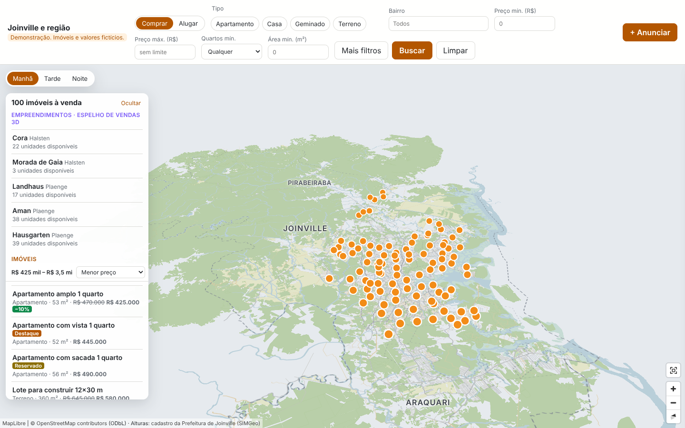

# Mapa 3D imobiliário: Joinville e Araquari (SC)

Protótipo de **demonstração** de um portal imobiliário com mapa 3D. **Joinville inteira (com o distrito de
Pirabeiraba) e Araquari** aparecem como uma maquete neutra (prédios em cinza), e só os imóveis à venda ficam
destacados e clicáveis.

> **Imóveis, imobiliárias e valores são FICTÍCIOS.** Os prédios, as vias, a água, as áreas verdes e os limites dos
> bairros vêm do OpenStreetMap (© OpenStreetMap contributors, ODbL).



**Online:** https://caioleonardosch.github.io/real-state-3d-web-viewer/ (publicado pelo workflow
`.github/workflows/pages.yml` depois que o CI (`.github/workflows/ci.yml`: testes, build, navegador e backend)
passa num push no `main`; na primeira vez é preciso escolher, em Settings → Pages →
Build and deployment, a fonte "GitHub Actions").

## Como instalar e rodar

Requisitos: Node.js 22+ e npm.

```bash
npm install
npm run dev       # servidor de desenvolvimento (http://localhost:5173)
npm run build     # tsc --noEmit + build de produção em dist/
npm run preview   # serve o dist/
npm test          # testes unitários (Vitest)
```

Os dados já estão versionados em `public/data/`, então o app funciona sem rede e sem nenhum servidor de tiles.

## Como adicionar imóveis

São três caminhos:

1. **Pelo app ("+ Anunciar")**: preencha o formulário (cadastro completo, ver abaixo), clique em **Escolher no mapa** e clique num prédio cinza
   (residencial e sem outro anúncio) ou, para terreno, num espaço livre. O lote é desenhado no ponto clicado com a
   área informada, na proporção 2,5:1. O anúncio aparece na hora no mapa e na lista com a marca "Seu anúncio" e
   fica salvo **só neste navegador** (`localStorage`). Para excluir, abra o anúncio e use **Excluir este anúncio**.
2. **Publicar para todos**: no formulário, use **Exportar meus anúncios (JSON)** e depois rode
   ```bash
   npm run listings:add -- meus-anuncios.json
   ```
   O script valida o arquivo com as mesmas regras do `listings.json`. Ids repetidos ganham sufixo, e um anúncio num
   prédio que já tem outro é recusado. O resultado combinado é validado de novo, e se falhar o `listings.json` volta
   ao original. Depois é só fazer o commit. Do endereço, vai para o arquivo público só o que o anunciante escolheu
   mostrar (o CEP nunca), como na view `public_listings`; a exportação já sai assim, e o script corta de novo.
3. **Gerar mais imóveis fictícios**: `npm run data:listings -- --count 50` (de 4 a 200; o padrão é 100). Mantém a
   proporção 5 : 4 : 3 : 3 entre apartamentos, casas, geminados e terrenos.

A validação de um anúncio no app, no script e no `validate:data` segue as mesmas regras: prédio residencial do
OSM (`scripts/lib/residential.mjs`), terreno dentro do bairro sem encostar em prédios, vias, água, áreas verdes ou
outro terreno, e círculo aproximado que contém o local real.

### Cadastro completo do anúncio

O formulário segue, em linhas gerais, o que os portais pedem (o padrão de fato é o XML que as imobiliárias enviam a
ZAP/VivaReal/OLX). Obrigatórios: local no mapa, preço (de venda e/ou aluguel), área, bairro, CRECI e WhatsApp. Fotos
são opcionais e sem limite de quantidade.

| Seção | Campos |
|---|---|
| Negócio | venda, locação ou ambos; preço de venda; aluguel mensal; condomínio; IPTU (por mês ou por ano); aceita financiamento/permuta; garantias da locação (caução, fiador, seguro fiança, título de capitalização) |
| Imóvel | tipo, finalidade (residencial/comercial), área útil e total, área do terreno, quartos, suítes, banheiros, vagas e vagas cobertas, andar da unidade, andares do edifício, torres, ano de construção (ou de entrega), obra, comodidades, descrição |
| Endereço | CEP (preenche rua, bairro e cidade pelo ViaCEP), rua, número, complemento, bairro (preenchido pelo ponto escolhido no mapa), cidade e **o que mostrar ao público**: endereço completo, só a rua ou só o bairro. Sem o endereço completo, o mapa mostra o raio de 150 m em vez do prédio |
| Mídia | fotos (sem mínimo nem máximo; capa escolhida, legendas), planta (imagem, entra no fim da galeria), vídeo (link do YouTube ou Vimeo, exibido embutido no anúncio) e link de tour 360° |
| Anunciante | imobiliária, CRECI, código de referência, contato, WhatsApp, telefone, e-mail, exclusividade (com o documento de autorização, que seria conferido pelo backend) |
| Publicação | situação (ativo, reservado, vendido), tipo de destaque (padrão, destaque, super destaque); datas de publicação e atualização automáticas |

As fotos são reduzidas no navegador (JPEG, lado maior de 960 px) porque o `localStorage` comporta poucos MB; com
backend elas iriam para um storage de arquivos. Os imóveis fictícios do gerador recebem os mesmos campos, **exceto
fotos, rua e contato**, para não inventar dados de lugares e pessoas reais: o endereço deles mostra só o bairro.

O painel do imóvel mostra a galeria de fotos (nativa, com a planta no fim), o vídeo embutido (YouTube pelo domínio
`youtube-nocookie.com`, ou Vimeo; outros links viram só link), endereço conforme a escolha do anunciante,
condomínio, IPTU, garantias, CRECI, código, datas, link do tour e o botão **Conversar no WhatsApp** (mensagem pronta
com o título e o código). No próprio anúncio, **Gerenciar anúncio** muda a situação e o preço e mostra o
**histórico de preço**, visível só para o anunciante.

Na busca, **Comprar / Alugar** troca o modo (`?negocio=alugar`): no aluguel, preços, faixa e ordenação usam o valor
mensal. A ordenação ganhou **Destaques primeiro** (super destaque, destaque, depois os mais recentes) e **Mais
recentes**.

### Verificações extras

```bash
npm run validate:data   # valida listings.json contra os GeoJSON do OSM
npm run build && npm run verify:e2e   # Playwright: abre o app, testa interações e salva screenshots em docs/screenshots/
npm run build && npm run verify:site  # Playwright: o site das imobiliárias (busca, favoritos, comparar, mapa embutido, editor)
```

O `verify:e2e` usa o Chromium indicado em `CHROMIUM_PATH` ou, se existir, `/opt/pw-browsers/chromium`. Caso
contrário, usa o navegador baixado pelo Playwright (`npx playwright install chromium`).

## Backend (Supabase)

O backend está começando: contas, imobiliárias (clientes), anúncios e fotos ficam num projeto
[Supabase](https://supabase.com) (Postgres + PostGIS, login, storage e regras de acesso no banco). Esquema em
`supabase/migrations/`; código do site em `src/backend/` e `src/ui/account.ts`.

- **Sem configuração**, o site é a demonstração de sempre (o GitHub Pages atual).
- **Com `VITE_SUPABASE_URL` e `VITE_SUPABASE_ANON_KEY`**, aparece o botão **Entrar**. O suporte da plataforma
  cadastra as imobiliárias e convida o dono; o dono convida os corretores (link de convite); quem é da imobiliária
  anuncia e edita. O anúncio vai para o banco, as fotos para o storage, e todos passam a ver. Excluir manda para
  uma lixeira (30 dias para restaurar), e os administradores leem o histórico de alterações em frases. O visitante
  manda mensagem ou pede uma visita (dia e período) pelo anúncio, com a autorização da LGPD; o contato chega ao
  corretor na conta e por e-mail. Os
  convites vão por e-mail, e os anúncios do CRM do cliente entram pelo XML (VRSync): o administrador informa o
  endereço do feed em Minha conta e ele é lido a cada 6 horas (workflow "Importar XML"), ou o suporte importa pela
  linha de comando, ver [`docs/importacao-xml.md`](docs/importacao-xml.md).
- **Páginas para o Google:** `npm run build` gera uma página estática por anúncio (`dist/imovel/…/`), o
  `sitemap.xml` e a prévia com foto para links compartilhados (`scripts/prerender.mjs`).

- **Carga do mapa:** o mapa recebe numa resposta só um resumo de cada anúncio (`map_listings`, com a foto de capa);
  a descrição, as fotos e o resto vêm quando a ficha é aberta. Assim o limite de 1.000 linhas por consulta do
  Supabase não esconde anúncios nem fotos (teste com 5.000 em `tests/backend/volume.test.ts`).

Com backend, a gestão (meus anúncios, desempenho de cada anúncio — visualizações, WhatsApp e mensagens —, contatos com filtro e planilha, lixeira, equipe) abre no painel do mapa ou em
página própria, `painel.html`, que não carrega o mapa. Passo a passo para criar o projeto e ligar o site: [`docs/supabase.md`](docs/supabase.md). Para testar localmente:
`npm run db:start`, `npm run test:backend` e `npm run verify:backend`.

## Site de cada imobiliária (white label)

`site.html` monta o site completo de uma imobiliária a partir da configuração dela (marca, cores, fontes, contatos,
menu, textos, seções da página inicial e jeito da busca), com cinco modelos prontos inspirados no que o mercado de
Joinville usa. Tem página inicial com busca rápida, busca com filtros (lateral ou no topo), chips, "Apenas com
desconto", grade, lista ou **mapa 3D** (o mapa deste projeto embutido, só com os imóveis da imobiliária e aceso
conforme a busca), ficha do imóvel com o prédio no mapa, favoritos, comparação, Sobre, Contato e Anunciar imóvel
(captação de proprietários). O dono edita tudo em **Personalizar site**, com pré-visualização ao vivo.

- Demonstração: `site.html` (Exemplo A, modelo *Leve*) e `site.html?imobiliaria=exemplo-b` (modelo *Escuro*),
  configurados em `public/data/sites.json`. Na demonstração, a personalização fica salva só no navegador.
- Com backend: `site.html?imobiliaria=<slug>` ou o domínio próprio do cliente; configuração em
  `organizations.branding`.
- No domínio do cliente, cada página sai do servidor com título, descrição, canônico e dados estruturados, em
  endereços limpos (`/imoveis`, `/imovel/<título>-<código>`), com `sitemap.xml` e `robots.txt` do cliente
  (`src/seo/siteServer.ts`; na Cloudflare Pages, `functions/[[path]].ts`).
- Código em `src/site/`; decisões e comparação com o mercado no item 12 de [`docs/backend.md`](docs/backend.md).

## Empreendimentos: espelho de vendas 3D

Cinco empreendimentos reais do bairro aparecem como torres violeta com um rótulo, e também no topo da lista:

| Empreendimento | Incorporadora | Situação | Unidades no mapa |
|---|---|---|---|
| Cora | Halsten | Em obras, entrega 08/2028 | 90 (6 por andar, 5º ao 19º) |
| Morada de Gaia | Halsten | Pronto (2025) | 56 |
| Landhaus | Plaenge | Em obras, entrega 04/2027 | 59 (número divulgado) |
| Aman | Plaenge | Lançamento, entrega 03/2029 | 67 (número divulgado), 20 andares |
| Hausgarten | Plaenge | Lançamento | 70 (número divulgado) |

- **Abrir** (clique na torre, no rótulo ou na lista): a torre se divide em pavimentos (térreo, garagem e lazer em
  cinza) e os andares de apartamentos em unidades coloridas pela situação: **verde** disponível, **amarelo**
  reservado, **cinza** vendido. O painel mostra o espelho de vendas (andares × finais), os totais e filtros
  ("Só disponíveis" e suítes mínimas). As unidades que não passam no filtro ficam translúcidas no mapa e na grade.
- **Unidade** (clique na grade ou no prédio): fica azul, os andares de cima ficam translúcidos para o andar aparecer,
  e a ficha mostra planta, área, suítes, vagas, andar, **face e sol** (hemisfério sul: norte = sol a maior parte do
  dia, leste = manhã, oeste = tarde, sul = pouco sol direto), preço ilustrativo e R$/m².
- **"Ver a vista da janela"**: a câmera vai para fora da fachada da unidade, na altura do andar + 1,6 m, olhando na
  direção da face (`calculateCameraOptionsFromCameraLngLatAltRotation`, com zoom e inclinação máximos liberados só
  nessa vista). Esc volta.
- **Link**: `?empreendimento=landhaus&unidade=1402`. Clicar num andar na grade mostra só aquele andar.
- **De onde vêm os dados** (seção recolhível no painel): o que é público (endereço, metragens, tipologias, número de
  unidades, prazos, com os links das fontes) e o que é estimado.

**Público × estimado.** Endereço, metragens, tipologias, número total de unidades e prazos vêm dos sites da Halsten e
da Plaenge e da imprensa (consulta em 08/10/2026). **São estimativas**: a distribuição das plantas por andar, o número
de andares quando não divulgado, o formato e a posição exata da torre (retângulo de frente para a rua do endereço,
área ≈ soma das unidades do andar × 1,3). **São fictícios**: preços (área × R$/m² de referência, +1% por andar) e
disponibilidade (sorteio com seed fixa, mais vendido nos andares altos e nos prontos). Os prédios do OSM que caem no
terreno da torre são ocultados (supostamente demolidos para a obra). Nada disso tem vínculo com as incorporadoras.

**Localização.** Endereços geocodificados no Nominatim pelo número. O nº 915 da Rua Benjamin Constant (Aman) não
existe no Nominatim e foi interpolado entre os nºs 900 e 975. O site da Plaenge cita "Glória" no endereço do Aman, mas
apresenta o empreendimento como do América.

**Para editar ou incluir um empreendimento**: altere `scripts/data/developments.mjs` (andares, plantas por final,
células que cada unidade ocupa na grade do andar, `expectedUnits` para conferir o total divulgado) e rode
`npm run data:developments`. O script falha se o total de unidades não bater ou se a torre não couber sem encostar
em ruas e outras torres.

**No backend** (incorporadora cliente): o suporte envia a torre desenhada com `npm run developments:upload`, e a
incorporadora atualiza situação, preços e reservas no mapa e em Minha conta, também por planilha. A reserva tem prazo
e vence sozinha; o preço pode ficar escondido do público. Ver [`docs/espelho-de-vendas.md`](docs/espelho-de-vendas.md).

Fora do bairro América, ficaram de fora: Amaluna e Soul (Halsten, Centro), Opera (Halsten, Atiradores), ONE e Vitra
(Plaenge, Atiradores) e Nola (Halsten, Cidade das Águas).

## Mapa em blocos (PMTiles) e 3D só de perto

O mapa base são **dois arquivos** de blocos vetoriais (vector tiles):

- `public/data/joinville.pmtiles` (≈14 MB, 164.672 prédios): prédios, vias (com o tipo de pavimento), água, áreas
  verdes, limites de bairro e a copa das matas;
- `public/data/joinville-detalhe.pmtiles` (≈10 MB, só o zoom 15 da área urbana): telhados, árvores, postes e a luz dos
  postes. Fica num arquivo à parte para os prédios aparecerem primeiro; o detalhe chega em seguida, só de perto.

O navegador **não baixa os arquivos inteiros**: o protocolo
`pmtiles://` (biblioteca `pmtiles`) lê só os blocos da área e do zoom na tela, com requisições HTTP de intervalo
(range). Não há servidor de mapas: qualquer hospedagem estática que aceite `Range` serve (GitHub Pages, S3, Cloudflare,
o `vite preview`).

| Zoom | Conteúdo dos blocos | Tamanho (comprimido) |
|---|---|---|
| 10 | vias principais, rios, verde e água ≥ 5 ha / 2 ha, bairros + prédios ≥ 1.500 m², só o contorno | até 71 KB por bloco |
| 11 | + ruas residenciais, verde ≥ 2 ha, água ≥ 0,5 ha; prédios ≥ 600 m² | até 117 KB |
| 12 | + verde ≥ 0,5 ha, água ≥ 0,1 ha, córregos; prédios ≥ 250 m² | até 168 KB |
| 13 | + vias de serviço e estradas rurais, verde ≥ 0,1 ha; prédios ≥ 120 m² | até 201 KB |
| 14–15 | todos os prédios, com altura e marca de residencial; calçadas e caminhos; copa das matas | até 214 KB (z14) e 75 KB (z15) |
| 15 (detalhe) | telhados, árvores, postes e luzes (low poly, em 3D) | até 113 KB |

São 2.532 blocos no arquivo base e 456 no de detalhe. De longe, cada camada leva só o que se enxerga naquele zoom
(e com a geometria simplificada): a primeira tela no celular, que usa os blocos 10 e 11, ficou com menos da metade
dos bytes. Vias apenas planejadas, em obra, plataformas e corredores internos não entram no mapa. Acima do zoom 15 o MapLibre amplia os blocos do 15 (overzoom). A visão geral e cada rua custam
algumas centenas de KB. Para comparar: o formato antigo (GeoJSON único) teria 58 MB só de prédios.

**3D só de perto, sem ficar "chapado" de longe:**

- de longe (zoom < 14,6) os prédios aparecem **planos**, como textura da cidade (`buildings-flat`), junto com ruas,
  verde e água. Os rótulos de lugar são HTML: cidades e distritos (Joinville, Araquari,
  Pirabeiraba) até o zoom 12,6, e bairros do 12,6 ao 15. Os nomes das ruas são desenhados pelo próprio estilo, a partir
  do zoom 16 (ver abaixo);
- a partir do zoom 14 eles **sobem** gradualmente até a altura cheia no 15,5
  (`fill-extrusion-height` interpolado pelo zoom), então a transição é contínua;
- com a câmera inclinada, o fundo da tela usa blocos de zoom menor, que não têm os prédios pequenos: **o centro da
  tela fica em 3D e o horizonte fica plano** sem código extra; ao mover o mapa, o 3D acompanha;
- imóveis à venda e empreendimentos ficam **sempre** em 3D, então se destacam na visão geral.

Uma "bolha" 3D exatamente circular em volta do centro não existe no MapLibre (as expressões de estilo não sabem a
distância até o centro da tela); exigiria uma camada customizada (Three.js). O efeito acima chega perto disso.

## Paisagem: pavimento, postes, árvores e água

Low poly, como os prédios: o objetivo é dar vida e escala ao bairro, não realismo. Tudo é gerado junto com os blocos
(`scripts/lib/scenery.mjs`), de forma determinística: os mesmos dados geram a mesma paisagem, e uma rua editada no OSM
não muda as árvores do resto da cidade.

- **Telhados** (`scripts/lib/roofs.mjs`): quase todos os prédios de Joinville no OSM são só um contorno
  (`building=yes`), então o telhado é estimado pelo formato, pelos andares e pelo uso; a tag `roof:shape`, quando existe,
  manda.
  - casas alongadas ganham **duas águas** e as quadradas **quatro águas** (um quarto troca, para as ruas não parecerem
    carimbadas), desenhados em degraus, com beiral e três cores (cerâmica, fibrocimento, telha escura);
  - torres de 5 andares ou mais ganham laje com a **caixa d'água e a casa de máquinas**;
  - contornos complexos (em L, com pátio), galpões grandes e prédios de 4 andares ficam com laje;
  - na última geração: 66.819 de duas águas, 60.794 de quatro águas, 925 torres com caixa d'água e 36.134 lajes;
  - o prédio de um anúncio não ganha telhado do mapa base (ele é desenhado pelo anúncio, inclusive na obra).
- **Pavimento** pela tag `surface` do OSM:
  - classes: asfalto, calçamento (lajota, paralelepípedo, paver), outro pavimento e estrada de chão; caminhos rurais
    (`track`) sem a tag contam como chão;
  - de perto: largura real das ruas, textura própria para o calçamento e o chão, calçadas nas ruas da cidade e faixas
    nas principais;
  - em km de rua de carro: 1.459 de asfalto, 377 de calçamento, 1.427 de chão, 44 de outro pavimento e 640 sem
    informação (cor neutra) (`meta.json`, `roadKmBySurface`).
- **Postes**:
  - 416 mapeados no OSM, mais um a cada 38 m nas ruas pavimentadas da área urbana, do lado direito (41.012 ao todo);
  - não entram em túneis, pontes, ruas de chão e onde o OSM diz `lit=no`;
  - à noite, cada um projeta no chão uma mancha larga e um ponto mais forte sob a luminária, na cor do tipo de luz,
    fixo por rua: LED branco neutro nas ruas principais, sódio alaranjado em 15% das outras e LED branco quente no
    resto; cada poste tem a sua intensidade;
  - **os postes ilustrativos não são as posições reais.**
- **Árvores**: 206.242, das quais 1.071 do OSM (árvores e fileiras):
  - o resto é ilustrativo, espalhado em praças, gramados e bordas de mata da área urbana, em três formatos e três tons;
  - as matas grandes viram uma copa facetada, recuada 6 m, com árvores na borda, em vez de árvores soltas: com elas
    eram quase 1 milhão de árvores, e a geração dos blocos estourava a memória;
  - nenhuma árvore ilustrativa a menos de 6 m de um prédio nem sobre a pista das ruas, e a copa da mata abre clareiras
    em volta dos prédios e ao longo das ruas de carro que a atravessam (`clearings` e `cutCanopy`, em
    `scripts/lib/scenery.mjs`).
- **Água**: de perto (zoom 13), textura facetada em tons claros e escuros e uma margem mais clara; de longe, cor
  lisa, que pesa menos na primeira tela. Rios e canais aparecem como linhas.
- **Sombras**: de dia, cada prédio projeta a sua sombra no chão, do lado oposto ao sol (oeste de manhã, leste à tarde),
  a partir do zoom 15. São calculadas no navegador quando a câmera para, com os blocos já carregados
  (`src/map/shadows.ts`), e não pesam no arquivo do mapa.
- **Onde aparece:** só de perto:
  - a copa das matas sobe junto com os prédios, a partir do zoom 14;
  - os telhados sobem com os prédios, a partir do zoom 15;
  - as árvores crescem do zoom 15 ao 16;
  - os postes aparecem no 16;
  - as luzes, no 15,5.

## Filtro por bairro

No filtro "Bairro" (ou `?bairro=Glória&bairro=Centro` no endereço, com ou sem acento), o mapa mostra **só os bairros
escolhidos e as ruas até 100 m das divisas**:

- prédios, vias, verde e água de fora somem;
- uma máscara cobre o chão de fora;
- os contornos dos outros bairros saem;
- o mapa enquadra a área.

Assim dá para ver o que está à venda nos limites do bairro sem a cidade inteira em volta.

- **Imóveis e empreendimentos:**
  - entram os imóveis com aquele bairro no endereço;
  - os empreendimentos fora do recorte somem do mapa e da lista.
- **Como funciona:**
  - a área de cada bairro, já crescida 100 m, vem pronta em `public/data/bairros-areas.geojson` (238 KB, 63 KB
    compactado, carregado só quando se escolhe um bairro);
  - o mapa filtra cada camada com a expressão `distance` do MapLibre;
  - a máscara é o mundo menos a união das áreas (`polygon-clipping`, também carregado sob demanda).
- **Limites:**
  - os bairros são os do OSM, e Araquari tem só parte deles mapeados;
  - um imóvel sem bairro no endereço não entra no filtro.

## Obras em andamento

Num prédio em construção, o mapa mostra **os andares prontos sólidos e o resto translúcido**, com uma grua low poly.
Vale para os anúncios "Em construção" e para os empreendimentos.

- **O que o anúncio mostra:**
  - a ficha e o site mostram "12 de 20 andares (60%)", com uma barra, o mês da informação e quem informou: o
    anunciante, uma vistoria da equipe ou uma imagem aérea;
  - uma informação com mais de 3 meses é marcada como antiga.
- **Quem atualiza:**
  - o anunciante, todo mês, pelo formulário do anúncio ("Andares já construídos" e "Andamento informado em");
  - no banco (migração `20261019000001_construction_progress.sql`):
    - quem anuncia só registra como "anunciante"; "vistoria" e "imagem" ficam para a equipe e para o serviço mensal;
    - cada mês fica em `construction_history`, para a linha do tempo da obra.
- **Na demonstração**, o andamento das 26 obras e dos empreendimentos Cora e Landhaus é ilustrativo
  (`scripts/lib/construction-demo.mjs`).
- A construtora é a fonte viável do andamento: a Lei 4.591/64, art. 31-D, já obriga um demonstrativo trimestral da
  obra quando há patrimônio de afetação. Por que não usamos imagem de satélite mensal:
  [`docs/avaliacao-2026-10.md`](docs/avaliacao-2026-10.md).

## Altura dos prédios: cadastro da Prefeitura

No OpenStreetMap, quase todos os prédios da região não têm altura. Agora a altura vem, em ordem de prioridade, de:

1. tag `height` do OSM (61 prédios);
2. `building:levels` do OSM × 3 m (2.543);
3. **pavimentos estimados pelo cadastro imobiliário da Prefeitura de Joinville** × 3 m (**153.274 prédios, 93,1%**);
4. 6 m, quando nada disso existe (8.794, 5,3%). Inclui **Araquari**, cujo cadastro não está no servidor de
   Joinville, e áreas rurais.

**Como a estimativa é feita** (`scripts/estimate-heights.mjs`, regra em `scripts/lib/cadastre-floors.mjs`):

- `npm run data:cadastre` baixa do servidor público do SIMGeo os 143.425 lotes urbanos (contorno + área construída)
  e as 55 outorgas onerosas (altura autorizada). As páginas têm 2.000 registros, uma de cada vez, com pausa.
- Cada prédio do OSM é ligado ao lote que contém o seu ponto interno.
- **Pavimentos ≈ área construída do lote ÷ área de projeção dos prédios do OSM no lote.**
  - Se há um prédio principal (≥ 70% da projeção), os anexos contam 1 pavimento e o principal fica com o resto.
  - Se há vários prédios parecidos (condomínio de casas), todos recebem o mesmo número, no máximo 4.
- **Descartes** (o prédio fica com o padrão):
  - razão < 0,2 ou > 32;
  - mais de 4 pavimentos num contorno menor que 150 m² (quase sempre a torre não está desenhada no OSM e só a
    guarita ou a garagem aparece);
  - mais de 4 pavimentos com menos de 70% do contorno dentro do lote: o ponto interno caiu num lote vizinho, e a
    área construída é a dele. O relatório mensal achou assim uma casa de Pirabeiraba com 29 andares.

  São 2.590 prédios nessa situação.
- A outorga onerosa, quando existe, limita a altura. Hoje não limitou nenhum prédio.
- Os apartamentos fictícios passaram a ocupar **prédios reais de 4 pavimentos ou mais** pelo cadastro, com esse
  número de pavimentos (antes: 8 a 14 inventados). As casas vão para prédios de até 2 pavimentos.

Conferência pelos nomes do OSM: Edifício HYDE 30 pavimentos, Ibis Styles 25, Helbor Offices 24.

A atribuição do mapa cita o cadastro da Prefeitura (SIMGeo). **Os dados são públicos, mas não encontrei licença
explícita.** Antes de usar em produto, confirme os termos com a SEPUR.UGP (simgeo@joinville.sc.gov.br). Detalhes e
outras camadas úteis em [`docs/dados-prefeitura.md`](docs/dados-prefeitura.md).

## Como regenerar os dados

Requisitos extras: Python 3 com `pip install osmium shapely`.

```bash
npm run data
# atrás de proxy HTTP(S), o fetch nativo do Node só usa o proxy com:
NODE_USE_ENV_PROXY=1 npm run data
```

1. `npm run data:download` (`scripts/download-osm.mjs`): baixa o extrato do OpenStreetMap de Santa Catarina
   (≈140 MB, OpenStreetMap France, atualizado diariamente) para `.cache/osm-pbf/` e confere o MD5. Não baixa de novo
   se o arquivo já estiver atualizado. (A API Overpass, usada antes, estava recusando conexões.)
2. `npm run data:region` (`scripts/extract-region.py`, pyosmium + shapely): recorta os bairros listados em
   `scripts/data/region.json` (polígonos `admin_level=10` dentro do município de Joinville; nomes repetidos em cidades
   vizinhas são descartados) e grava GeoJSON em `.cache/region/` (≈22 MB, **não versionado**). Um prédio entra se o
   seu ponto interno estiver na região; vias, rios e áreas verdes entram se tocarem a região (+60 m).
   Também extrai as árvores e os postes mapeados, a copa das matas (recuada 6 m) e a área de cada bairro crescida
   100 m (para o filtro por bairro).
3. `npm run data:tiles` (`scripts/build-tiles.mjs`): gera os blocos com `geojson-vt` + `vt-pbf`, comprime cada
   bloco com gzip e grava o `.pmtiles` com um gravador próprio (`scripts/lib/pmtiles-writer.mjs`, especificação v3:
   diretório raiz, diretórios-folha quando necessário, blocos repetidos guardados uma vez), com a paisagem
   (`scripts/lib/scenery.mjs`). Também grava `boundary.geojson`, `bairros.geojson` (pontos dos rótulos),
   `bairros-areas.geojson` (filtro por bairro) e `meta.json`. Leva menos de 1 minuto e usa até ~4,3 GB de memória.
4. `npm run data:listings` (`scripts/generate-listings.mjs`): imóveis fictícios de forma determinística
   (seed `20261007`), espalhados pela região. Aceita `--count N` (padrão 60). Cada imóvel em prédio leva o contorno
   (`footprint`) e a altura do prédio do OSM, porque o app não tem mais o arquivo de prédios inteiro. As comodidades
   vêm de um gerador aleatório separado (seed + 1); um título que promete "piscina" ou "sacada" sempre a tem.
5. `npm run data:developments`: empreendimentos (ver acima).
6. `npm run validate:data`: verificações de consistência (ver abaixo), contra os dados de `.cache/region/`.

Entre os passos 2 e 3 rodam `npm run data:cadastre` (cadastro da Prefeitura, em `.cache/cadastre/`) e
`npm run data:heights` (pavimentos por prédio, em `.cache/region/heights.json`). Sem eles, os blocos e os imóveis
usam só as alturas do OSM e o padrão de 6 m, e os apartamentos voltam a ter pavimentos fictícios.

**Relatório de mudanças:** `npm run map:changes -- --old <mapa-anterior.pmtiles> --old-meta <meta-anterior.json>`
compara o mapa novo (`public/data/`) com um anterior. Ele lista:

- prédios novos, removidos e redesenhados (mesmo lugar, id novo no OSM);
- alturas que mudaram 3 m ou mais, por bairro;
- quilômetros de rua por pavimento, árvores, postes e a origem das alturas;
- os anúncios cujo prédio mudou.

Aceita `--out relatorio.md` e `--json resumo.json`. Lê os 164 mil prédios em cerca de 4 segundos.

### Serviço mensal do mapa

O workflow `.github/workflows/mapa-mensal.yml` refaz o mapa **no dia 3 de cada mês**, ou quando rodado à mão em
Actions → Mapa mensal → Run workflow:

1. baixa o OSM e o cadastro;
2. recalcula as alturas e gera os blocos;
3. roda os testes;
4. abre um pull request com o relatório de mudanças no corpo.

**O mapa novo só vai ao ar quando alguém aprova o PR.** Antes, confira no relatório:

- as alturas que mudaram 15 m ou mais, que podem ser erro de edição no OSM;
- se alguma fonte de altura caiu de repente;
- os anúncios afetados.

Se o servidor da Prefeitura estiver fora do ar, o job falha antes de mexer em qualquer coisa: sem o cadastro, as
alturas cairiam para 6 m.

Na primeira vez, marque em Settings → Actions → General → Workflow permissions a opção "Allow GitHub Actions to
create and approve pull requests". Cada mês acrescenta ~20 MB ao histórico do git. Quando pesar, publique o
`.pmtiles` num armazenamento de objetos com nome por versão (veja `docs/backend.md`, item 13).

**Para mudar a região**, edite `scripts/data/region.json` (municípios, extrato do OSM, cidade, fuso, cadastro) e
rode `npm run data:download`, `data:region`, `data:tiles` e, se quiser imóveis nos novos bairros, `data:listings`.
O nome da cidade nos títulos, formulários e páginas sai desse arquivo. Outra cidade sem cadastro de alturas usa só
o OSM; o passo a passo e o que ainda é de Joinville estão em [`docs/nova-regiao.md`](docs/nova-regiao.md). A cidade
inteira funciona do mesmo jeito: o tamanho do `.pmtiles` cresce, mas o que cada visitante baixa continua sendo só o
que está na tela.

## Estrutura

```
scripts/        download-osm, extract-region.py, build-tiles, generate-listings, generate-developments,
                validate-listings, add-listings, e2e-check; lib/ (altura, residencial, gravador PMTiles)
scripts/data/   região (bairros) e empreendimentos
public/data/    GeoJSON do OSM + listings.json (fictício) + meta.json + sites.json (sites de demonstração)
src/data/       tipos, validação em tempo de carga, carregamento
src/state/      filtros (lógica pura, FilterStore pendente × aplicado, sugestões p/ busca vazia), ordenação, URL,
                anúncios salvos no navegador (userListings)
src/map/        cena MapLibre (destaque, hover, câmera, sombras), estilo do mapa base (baseStyle.ts) e iluminação
src/ui/         filtros (+ "Mais filtros"), lista de resultados, drawer, formulário "Anunciar", seletor manhã/tarde/noite
src/site/       site de cada imobiliária (site.html): configuração e tema, busca, cards, editor; páginas em pages/
src/panel/      gestão em página própria (painel.html), sem o mapa
src/utils/      simulação de financiamento, planta SVG ilustrativa, formatação, regras de posição de novos anúncios
scripts/lib/    regras compartilhadas entre scripts e app (altura dos prédios, prédio residencial)
docs/           screenshots e análise da concorrência (docs/analise-concorrencia.md)
tests/          Vitest: renderHeight, filtros e sugestões, ordenação/resumo de preço, URL, simulação de financiamento,
                geometria de novos anúncios
docs/screenshots/  capturas geradas pelo verify:e2e
```

## Versões usadas (confirmadas com `npm view` e nos `.d.ts` instalados)

| Pacote | Versão |
|---|---|
| maplibre-gl | 6.13.0 |
| @turf/* (módulos individuais) | 7.4.0 |
| pmtiles | 4.5.0 |
| geojson-vt | 4.0.3 |
| vt-pbf | 3.1.3 |
| pyosmium (Python) | 4.3.1 |
| shapely (Python) | 2.2.0 |
| suncalc | 2.1.1 |
| vite | 8.3.3 |
| typescript | 7.0.2 |
| vitest | 5.0.3 |
| playwright | 1.63.0 |

### Adaptações às APIs instaladas

- **MapLibre 6** só tem exports nomeados (`import { Map } from 'maplibre-gl'`, sem `default`). Ele carrega o worker de
  um arquivo separado (`maplibre-gl-worker.mjs`), que o Vite não emite sozinho. Por isso o app importa esse arquivo com
  `?url` e chama `setWorkerUrl()` (veja `src/main.ts`).
- **Luz no MapLibre 6**: a especificação `light` tem só `anchor`, `position [r, azimute, polar]`, `color` e `intensity`.
  Ela sombreia as faces das extrusões conforme a direção da luz, mas **não projeta sombras** no chão nem entre prédios.
  Também usamos `sky` (`sky-color`, `horizon-color`, `fog-color`), que aparece quando a câmera mostra o horizonte.
- **suncalc 2.x** traz tipos próprios e mudou a convenção da 1.x: `azimuth` e `altitude` vêm em **graus**, com azimute a
  partir do **norte**, no sentido horário. Na 1.x eram radianos, medidos a partir do sul. O pacote `@types/suncalc`
  (que descreve a 1.x) foi removido. O mapeamento para o MapLibre fica `position = [1.5, azimute, 90 − altitude]` com
  `anchor: "map"`.
- **Turf 7.4**: `nearestPointOnLine` marca `dist` e `index` como obsoletos. Usamos `pointDistance` e `segmentIndex`.
- **Playwright 1.63** espera um build de Chromium que não estava instalado no ambiente. O script aceita
  `executablePath` (Chromium pré-instalado) em vez de baixar outro.

## Decisões e premissas

- **Limite da região**: união dos municípios de **Joinville e Araquari** (`admin_level=8` no OSM), configurável em
  `scripts/data/region.json` (municípios inteiros ou uma lista de bairros). O limite externo aparece tracejado; os
  limites entre bairros, em tracejado mais fraco.
- **Área urbana para os imóveis fictícios**: a região inclui serra e área rural, então o gerador só usa células de
  ~1 km com pelo menos 300 prédios.
- **Preço reduzido**: `previousPrice` (maior que `price`) e `priceReducedAt`. A lista, a etiqueta e o painel mostram o
  preço anterior riscado, o percentual ("−10%") e a data ("Preço reduzido em 22/09/2026"). Em "Mais filtros",
  **Ofertas → Preço reduzido** filtra (`?reduzido=1`). O anunciante **não digita** o preço anterior: a redução
  aparece quando ele baixa o preço de um anúncio já publicado (em "Gerenciar anúncio"), e cada mudança fica em
  `priceHistory`. Assim o desconto vem do histórico registrado na plataforma, não de um valor declarado. O gerador
  dá redução de 4% a 15% a ~20% dos imóveis.
- **Altura dos prédios (`renderHeight`)**: tag `height`, se válida; senão `building:levels × 3 m`; senão 6 m.
  Valores como `"12 m"` e `"7,5"` são aceitos. Valores inválidos (`"3;4"`) caem na regra seguinte.
- **Prédios residenciais elegíveis** para imóveis: `building` ∈ {yes, house, residential, apartments, detached,
  semidetached_house, terrace}, sem as tags `amenity`, `shop`, `office`, `healthcare`, `craft`, `tourism`,
  `leisure`, `religion`, `denomination` e `industrial`, e **sem `name`**. Prédios com nome costumam ser pontos de
  referência, então foram excluídos por precaução. O centróide precisa estar dentro da região. A marca
  `residential` é calculada ao gerar os blocos, e o "Anunciar" a usa para recusar prédios não residenciais.
- **Apartamentos** só usam prédios com área de projeção ≥ 250 m². A altura do prédio no mapa é sobrescrita por
  `floors × 3 m` (8 a 14 pavimentos fictícios).
- **Geminados**: se houver pelo menos 3 prédios marcados como `semidetached_house` ou `terrace`, só eles são usados;
  senão, prédios residenciais de 50 a 220 m².
- **Espalhamento**: seleção por *farthest-point sampling* determinística, ou seja, cada novo imóvel fica o mais longe
  possível dos já escolhidos.
- **Terrenos**: retângulos de 12×30, 15×30, 15×35 ou 20×40 m, alinhados ao segmento da via carroçável mais próxima,
  com a frente voltada para ela. Precisam estar dentro do limite e **não podem intersectar** prédios, vias, água, áreas
  verdes ou outro terreno (validado com Turf). Se não houver espaço, o tamanho é reduzido para 10×25 e depois 8×20 m,
  com registro. A extrusão é de 0,5 m.
- **Localização aproximada** (3 imóveis: 1 casa, 1 geminado e 1 terreno): o centro exibido é deslocado de 50 a 149 m
  numa direção derivada do hash do `id`, de forma determinística. O mapa mostra um círculo de 150 m e não destaca o
  imóvel exato, cujo prédio fica cinza como os demais. Como o deslocamento é menor que o raio, o círculo sempre contém
  o local real.
- **Preços** são **valores ilustrativos**: área × R$/m² sorteado em faixas plausíveis (apartamento 8.000–11.500,
  casa 6.500–9.500, geminado 5.800–7.800, terreno 1.400–2.400 por m² de lote), arredondados a R$ 5.000. Não refletem
  o mercado real.
- **Imobiliárias**: "Imobiliária Exemplo A" e "Imobiliária Exemplo B", alternadas entre os imóveis.
- **Drawer**: mostra também o preço por m² e as comodidades. Anúncios criados no navegador têm selo azul "Seu anúncio"
  e o botão **Excluir este anúncio**.
- **Anunciar imóvel**: o painel abre à direita. Durante a escolha no mapa ele vira uma faixa com a instrução, o
  cursor vira mira e cliques no mapa não abrem anúncios. Esc cancela a escolha (ou fecha o painel). O local
  escolhido aparece em azul (`pick-preview`); apartamentos usam a altura `pavimentos × 3 m`, se informada.
  Prédios com nome, não residenciais ou já anunciados são recusados com o motivo. Sem título, o anúncio recebe um
  título automático ("Casa 3 quartos", "Terreno de 300 m²"). Um anúncio recém-salvo é aberto mesmo que os filtros
  aplicados o escondam.
- **Títulos e descrições** são genéricos e não citam nomes de ruas, para não sugerir endereço real.
- **Filtros principais**: tipo, preço mín./máx., quartos mín. e área mín.
- **"Mais filtros"** (seção recolhível; o botão mostra quantos estão ativos, ex.: "Mais filtros (2)"): banheiros mín.,
  vagas mín., área máx., **R$/m² máx.** (preço ÷ área), imobiliária, situação (pronto/em construção) e
  **comodidades**: piscina, churrasqueira, sacada, elevador, academia, aceita pets, mobiliado, aceita financiamento
  e aceita permuta. Com várias comodidades marcadas, o imóvel precisa ter **todas**. Ao buscar, a seção se recolhe.
- **Filtros (comportamento)**: o formulário altera só o estado *pendente* (`FilterStore.setPending`), e o mapa só muda com **Buscar**
  (`apply()`). **Limpar** zera o formulário e também a busca aplicada, por ser um clique explícito. Um aviso
  "Alterações não aplicadas" aparece quando o formulário difere do que está aplicado.
- **Pinos**: um círculo laranja com borda (camada `circle` do MapLibre, sem ícones nem fontes externas) no centro de
  cada imóvel. Ficam visíveis na visão geral e somem gradualmente entre os zooms 15,5 e 16,5, quando o prédio ou
  terreno destacado já é legível. Clicar ou passar o mouse no pino equivale a fazê-lo no imóvel. Imóveis fora da
  busca têm pino cinza menor e não clicável.
- **Câmera inicial**: enquadra todos os imóveis (com a inclinação de 58°), para nenhum começar fora da tela. O limite
  de navegação continua sendo o do bairro.
- **Etiqueta ao passar o mouse**: elemento HTML próprio (não o `Popup` do MapLibre) que segue o cursor e mostra
  preço, tipo, área, quartos, aviso de localização aproximada e "Clique para ver detalhes". Some ao sair do imóvel,
  ao clicar e enquanto o mapa é arrastado ou girado. Imóveis esmaecidos pela busca não mostram etiqueta. Em tela de
  toque não há hover, e o toque abre o painel direto.
- **Lista sempre disponível** (`ResultsPanel`): sem filtro mostra "30 imóveis à venda"; com filtro, "N imóveis
  encontrados de 30". Tem faixa de preço, ordenação e linhas clicáveis, e pode ser recolhida. No desktop começa
  aberta, e a câmera desconta ~340 px à esquerda para nenhum imóvel ficar sob ela. No celular começa recolhida num
  botão compacto e continua recolhida após "Buscar" (o botão já mostra a contagem); ela também se recolhe ao abrir um
  imóvel por ela. É o caminho de teclado e leitor de tela para todos os imóveis.
- **Hover sincronizado**: passar o mouse (ou o foco do teclado) numa linha acende o imóvel e o pino no mapa; passar o
  mouse no imóvel no mapa marca a linha.
- **Anterior/próximo no painel**: percorre a lista atual na ordem exibida; botões desativados nas pontas; setas ← →
  funcionam com o foco no painel.
- **Ordenação**: menor preço (padrão), maior preço, maior área, menor preço/m². Como só reordena a lista e não filtra, aplica na hora,
  sem "Buscar". A faixa de preço usa um formatador compacto próprio ("R$ 505 mil – R$ 2,8 mi"), porque o
  `Intl` com `notation: 'compact'` gerava "R$ 505,0 mil" e varia entre versões de ICU.
- **Busca sem resultados**: para cada filtro ativo, calcula quantos imóveis apareceriam sem ele e o valor mais próximo
  disponível (o mais barato, o maior etc.), e mostra as duas melhores sugestões como botões "Remover …". Clicar é uma
  ação explícita, como "Buscar": atualiza o formulário e refaz a busca.
- **URL compartilhável**: `?imovel=&tipo=&precoMin=&precoMax=&quartos=&banheiros=&vagas=&area=&areaMax=&m2Max=&situacao=&comodidades=&imob=&ordem=`,
  com slugs em português (`tipo=casa,terreno`, `situacao=em-construcao`, `comodidades=piscina,pets`,
  `ordem=menor-preco-m2`). Valores inválidos são ignorados e removidos da URL ao carregar.
  - Abrir um imóvel cria uma entrada no histórico, então o "voltar" do navegador fecha o painel.
  - Buscar, ordenar e anterior/próximo só substituem a entrada atual.
  - Fechar pelo ×/Esc/mapa usa `history.back()` quando a entrada foi criada pela abertura do painel e nada mudou
    desde então; senão, só remove `imovel` da URL. Isso evita que "fechar" desfaça uma busca feita com o painel aberto.
- **Painel no celular em dois estágios**: abre recolhido (faixa de 166 px com navegação, selo, título e preço). Tocar
  na alça ou na faixa, ou arrastar para cima, expande; arrastar para baixo recolhe e, já recolhido, fecha. Os controles
  do mapa e a atribuição sobem junto. Ao navegar com anterior/próximo, o estado (recolhido/expandido) é mantido.
- **Botão "Visão geral"**: controle do MapLibre acima do zoom que volta, com animação, ao enquadramento inicial.
- **Acessibilidade**: atalho "Pular para a lista de imóveis" (primeiro item do Tab), anúncio da contagem da busca numa
  região `aria-live` separada (a lista em si não é `aria-live`, para não ser relida inteira), foco devolvido à linha da
  lista quando o painel fecha, e contorno de foco visível.
- **Imóveis esmaecidos**: cinza semitransparente (opacidade 0,4) e não clicáveis; o pino fica cinza e menor. Quando o filtro inclui algum imóvel,
  a câmera enquadra todos os resultados (`fitBounds`).
- **Contorno**: as extrusões do MapLibre não têm contorno próprio, então o destaque usa uma camada `line` na base
  do polígono.
- **Iluminação**: data de referência fixa em 20/03/2026 (equinócio), fuso UTC−03:00 (Joinville não tem horário de
  verão desde 2019). Manhã às 09:00, tarde às 15:00, noite às 21:00 (sol abaixo do horizonte). As coordenadas vêm de
  `meta.json`, gravado pelo Nominatim. À noite, como não há sol, usamos uma luz fraca, fria e vinda de cima, para os
  volumes continuarem legíveis.
  - A altitude do sol é limitada a um ângulo polar entre 10° e 80°, para as faces não ficarem totalmente escuras.
- **Planta**: SVG genérico com retângulos (sala, cozinha, quartos, banhos), em escala proporcional à raiz da área.
  Também só na demonstração: em produção, a ficha mostra a planta apenas quando o anunciante envia uma.
  Terrenos mostram só o contorno do lote.
- **Simular financiamento** (imóveis à venda, no mapa e no site): SAC ou Price com a taxa efetiva anual que o
  visitante digitar (11,5% ao ano de partida), entrada, FGTS e prazo de até 35 anos; mostra parcelas, total de
  juros e a renda para a parcela caber em 30% dela, e avisa quando o financiado passa de 80% do valor. Sem TR,
  seguros e taxa de administração, como diz o aviso (`src/utils/financing.ts`).
- **Sem servidor de tiles e sem fontes externas**: o estilo não tem `glyphs` nem `sprite`. Os nomes das ruas usam
  `font-faces` do MapLibre: a fonte Inter 500 (só latim, 24 KB, servida pelo próprio site) é desenhada no navegador,
  sem arquivos de glifos. Aparecem do zoom 16 em diante, deitados ao longo da rua e de frente para a câmera, acima dos
  prédios. O nome das ruas só existe no zoom 15 de `joinville.pmtiles` (+190 KB).
- **Busca "Bairro ou rua"**: a caixa sugere bairros e ruas. A lista de ruas (`public/data/ruas.json`, 542 KB, 165 KB
  com gzip) é baixada só quando a pessoa começa a digitar. Cada rua aparece uma vez por bairro (ou distrito, ou
  cidade) e leva o mapa até o trecho mais longo dela ali, com a rua destacada. "Imóveis nesta rua" filtra só os
  anúncios que mostram a rua (`addressDisplay` `full` ou `street`); quem mostra só o bairro fica de fora, senão o filtro
  revelaria o endereço. A rua escolhida vai para o link (`?rua=`).

## Limitações conhecidas

- O MapLibre não projeta sombras. A "direção do sol" aparece só no sombreamento das faces dos prédios.
- **Postes e a maior parte das árvores são ilustrativos:** o OSM tem só 416 postes e cerca de mil árvores na região.
  As posições não são as reais; servem para dar escala e vida à rua.
- O filtro por bairro usa os bairros do OSM. Araquari tem só parte dos bairros mapeados, e um imóvel sem bairro no
  endereço não entra no filtro.
- Muitos prédios do OSM não têm altura nem número de pavimentos e usam a altura padrão de 6 m. Veja as contagens abaixo.
- A qualidade do mapeamento de prédios no OSM varia. Pode haver quadras sem prédios mapeados ou com contornos
  desatualizados.
- O bundle JS tem ~1 MB, quase todo do MapLibre. Não houve otimização de tamanho.
- Os terrenos fictícios ficam em áreas sem prédio **mapeado** no OSM. Na realidade podem existir construções ali.
- O contorno dos imóveis é desenhado só na base do volume.
- Muitos prédios do OSM têm só `building=yes`. Um prédio "residencial" escolhido pode, na realidade, ser comercial ou
  galpão, porque o filtro depende das tags existentes.
- A altura pelo cadastro é uma **estimativa**: supõe 3 m por pavimento e pavimentos de área igual. Ela erra em
  prédios com embasamento largo e torre estreita, em subsolos contados como área construída e em lotes onde o OSM e o
  cadastro não batem. O cadastro também pode estar desatualizado em relação às obras recentes.
- O "Anunciar" escolhe prédios só de perto (zoom ≥ 14, já em 3D). A checagem de terreno livre usa os blocos
  carregados na tela; um prédio que cruza a borda de um bloco vem recortado com uma margem de ~30 m, então
  contornos muito grandes podem chegar incompletos na pré-visualização.
- Anúncios salvos no navegador por versões anteriores (sem o contorno do prédio) são descartados ao carregar.
- Durante voos de câmera o MapLibre às vezes pede ao mapa base um bloco acima do zoom 15, e esse pedido falha
  ("Failed to fetch"). O bloco é descartado e o do zoom 15 ampliado é usado, sem buraco no mapa. Esses casos vão
  para o console como aviso (`console.warn`); outros erros do mapa continuam como erro.
- Os gestos do painel no celular (arrastar para cima/baixo) usam Pointer Events e foram testados com o mouse
  emulando o arrasto num viewport de celular, não com toque real num aparelho.
- A acessibilidade foi verificada por automação (ordem do Tab, foco, `aria-live`, rótulos). Não testei com leitores
  de tela reais (NVDA, VoiceOver, TalkBack). O mapa 3D em si continua sendo só visual; a lista é a alternativa.
- A renderização foi verificada só em Chromium headless com WebGL por software (SwiftShader). Não testei Safari,
  Firefox nem GPUs reais.

- Anúncios criados pelo app ficam só no `localStorage` do navegador: não aparecem para outras pessoas até serem
  exportados e incorporados com `npm run listings:add`. Depois de salvo, **Editar anúncio** (no painel do imóvel)
  altera tudo, inclusive local e fotos. As fotos ocupam o pouco espaço do
  `localStorage`, então muitos anúncios com muitas fotos podem esbarrar no limite do navegador.
- O lote de um terreno criado no app é alinhado ao norte, não à rua mais próxima como no gerador.
- Para um prédio de apartamentos criado no app sem número de pavimentos, a altura no mapa é a do OSM (muitas vezes
  6 m por falta de dados).

## Próximos passos (não implementados)

A lista completa do que falta, em ordem de prioridade (com impacto, esforço, risco e dependências), está em
[`docs/prioridades.md`](docs/prioridades.md). A auditoria que a originou está em
[`docs/auditoria-2026-10-17.md`](docs/auditoria-2026-10-17.md).

- Modelo 3D detalhado de um prédio "hero" com janelas por unidade e janelas acesas à noite, com Three.js como camada
  customizada do MapLibre (o `fill-extrusion` não suporta isso).
- Dados de imóveis vindos de uma API, com paginação e URL compartilhável da busca.
- Backend (contas, anúncios, fotos, leads, espelho de vendas) e hospedagem multi-cliente: ver
  [`docs/backend.md`](docs/backend.md).
- Favoritos, alertas e as demais melhorias priorizadas em
  [`docs/analise-concorrencia.md`](docs/analise-concorrencia.md).
- Espelho de vendas com dados reais da incorporadora (planta do pavimento-tipo, tabela de unidades e de preços),
  integração com o sistema de vendas para a disponibilidade em tempo real, e modelo 3D da fachada.
- Divisão do bundle (lazy-load do MapLibre) e simplificação da geometria dos prédios para dispositivos fracos.
- Mapa (ver [`docs/avaliacao-2026-10.md`](docs/avaliacao-2026-10.md)):
  - melhorias pedidas em 15/10: casas fora da mata, luz dos postes mais natural e sombra dos prédios no chão já
    feitas; faltam, nesta ordem, nomes das ruas (e a rua na busca), serviços por perto, relevo com a câmera sempre
    acima do chão, e a régua de horário com o sol de cada apartamento;
  - pavimento da Secretaria de Infraestrutura para completar os 640 km sem informação;
  - LiDAR da Prefeitura e um estéreo único do núcleo vertical para as torres;
  - classificador de telhado (plano, duas águas, quatro águas);
  - cadastro real da iluminação pública.

## Dados (contagens da última execução)

Extrato OSM de 13/10/2026 (`santa-catarina-latest.osm.pbf`), recortado em 14/10/2026 (`public/data/meta.json`):

| Camada | Feições |
|---|---|
| Prédios (`building`) | 164.672 |
| ↳ altura pela tag `height` | 61 |
| ↳ altura por `building:levels × 3 m` | 2.543 |
| ↳ altura estimada pelo cadastro da Prefeitura | 153.274 |
| ↳ altura padrão de 6 m | 8.794 |
| Vias (`highway`) | 19.090 |
| Água (`natural=water`, `waterway`) | 2.099 |
| Áreas verdes (parques, gramados, matas, mangue, campos) | 2.730 |
| Árvores no mapa (1.071 do OSM, o resto ilustrativo) | 206.242 |
| Postes no mapa (416 do OSM, o resto ilustrativo) | 41.012 |

- Joinville e Araquari, 53 bairros com nome no OSM; bbox −49,200842, −26,599012, −48,650741, −26,074239 (W, S, E, N).
- `joinville.pmtiles`: 2.532 blocos, zooms 10 a 15, ≈14 MB; `joinville-detalhe.pmtiles`: 456 blocos, zoom 15, ≈10 MB.
- Telhados: 66.819 de duas águas, 60.794 de quatro águas, 925 torres com caixa d'água, 36.134 lajes.
- Ruas de carro por pavimento: 1.459 km de asfalto, 377 km de calçamento, 1.427 km de chão, 44 km de outro
  pavimento e 640 km sem informação.

Imóveis fictícios (`listings.json`): 100 no total (`--count 100`), na área urbana.

| Tipo | Quantidade | Observação |
|---|---|---|
| Apartamentos | 34 | Em prédios reais de 4+ pavimentos (estimativa pelo cadastro) |
| Casas | 26 | |
| Geminados | 20 | Escolhidos por área: o OSM não tinha ≥ 3 prédios `semidetached_house`/`terrace` |
| Terrenos | 20 | Nenhum precisou ser reduzido |

- 19 com preço reduzido; 3 com localização aproximada: `house-35`, `semi-61` e `land-81`.
- 14 também para alugar; 12 reservados; 9 com destaque e 4 com super destaque.
- 26 em construção, com andamento ilustrativo (15% a 90% dos andares).
- Prédios residenciais elegíveis (área urbana): 151.944.

## Verificação realizada

- `npm run build` (inclui `tsc --noEmit`): sem erros. Há só o aviso de chunk > 500 kB, por causa do MapLibre.
- `npm test`: 125 testes (mais 39 do backend em `npm run test:backend`): obra em andamento (mês, andamento e grua),
  relatório mensal do mapa (lê os 164 mil prédios do mapa publicado; novos, removidos, redesenhados e alturas),
  paisagem (pavimento, árvores, postes, simplificação), filtro por bairro na busca e na URL, regra da torre fora do
  lote, conversão banco ↔ site, vídeo embutido (só YouTube/Vimeo), endereço conforme a exibição escolhida, link de WhatsApp, venda × aluguel (filtro, ordenação, link), destaques primeiro, preço reduzido (filtro, link, percentual), estimativa de pavimentos pelo cadastro, gravador de PMTiles (conferido pela leitura com a biblioteca `pmtiles`, com e sem
  diretórios-folha), renderHeight, filtros + FilterStore, filtros avançados e comodidades, sugestões para busca
  vazia, ordenação e resumo de preço, leitura/escrita da URL com os novos parâmetros, simulação de pagamento,
  geometria de lotes e localização aproximada de novos anúncios, regra de prédio residencial, empreendimentos:
  totais de unidades divulgados, andares sem sobreposição, unidades de um andar sem sobreposição, torres sem
  sobreposição, face → sol, link com empreendimento e unidade.
- `npm run validate:data`:
  - ids únicos e `fictional: true` em todos; comodidades válidas e sem repetição;
  - terrenos não se sobrepõem;
  - todo `buildingOsmId` existe e é residencial, sem as tags excluídas;
  - terrenos dentro do limite e sem interseção com prédios, vias, água ou verde;
  - círculos aproximados contêm o local real.
- `npm run verify:e2e` (Playwright + Chromium headless com SwiftShader), 76 checagens:
  - filtro por bairro: link sem acento acha o bairro, lista só os imóveis dele e recorta o mapa (100 m em volta,
    resto coberto, sem os outros contornos nem empreendimentos de fora); tirar o bairro mostra a cidade de novo;
  - de perto: árvores, postes e ruas por pavimento (asfalto e calçamento); de dia sem luzes; ao trocar para a
    noite já perto da rua, os postes acendem;
  - visão geral da região com os prédios planos e sem 3D (o 3D só aparece de perto);
  - atribuição e banner visíveis;
  - na visão geral há um pino por imóvel, o pino abre a etiqueta e o painel, e os pinos somem no zoom 17,5;
  - passar o mouse mostra a etiqueta com o preço certo e cursor de mão, e sair a esconde;
  - clique abre o drawer, e Esc, o botão × e o clique no mapa vazio fecham;
  - localização aproximada;
  - editar filtros **não** altera o mapa nem a câmera, e só "Buscar" aplica;
  - lista de resultados abre o imóvel e "Limpar" restaura;
  - manhã, tarde e noite geram renderizações diferentes, com o sol a leste de manhã, a oeste à tarde e abaixo do horizonte à noite;
  - sem erros no console nem respostas HTTP ≥ 400;
  - lista de todos os imóveis disponível sem buscar; recolher/expandir; hover sincronizado nos dois sentidos;
  - anterior/próximo por botões e setas; ordenação por preço sem mexer no mapa, com faixa de preço;
  - busca vazia sugere o filtro a remover (com o valor mais próximo), e a sugestão refaz a busca; pinos cinza visíveis;
  - URL: abrir grava `?imovel=`, "voltar" fecha o painel, a busca grava os filtros, link compartilhado restaura
    filtros/lista/imóvel, link inválido é ignorado;
  - botão "Visão geral" restaura o enquadramento inicial;
  - teclado: Tab → atalho → linha → Enter abre → Esc fecha e devolve o foco; anúncio da contagem para leitor de tela;
  - "Mais filtros": abre, conta os critérios ativos ("Mais filtros (2)"), filtra por comodidade + banheiros e grava
    `?banheiros=2&comodidades=piscina`;
  - "Alugar" lista os imóveis para aluguel com preço mensal e grava `?negocio=alugar`;
  - "Anunciar": cadastro incompleto (sem CRECI) é recusado; casa num prédio cinza e terreno num espaço
    livre são salvos, abertos e aparecem na lista, com galeria, endereço só da rua e link de WhatsApp; baixar o
    preço no "Gerenciar anúncio" mostra o preço riscado e o histórico (só para o anunciante); "Editar anúncio" abre o
    formulário preenchido e salva título, fotos e capa; continuam após recarregar e podem ser
    excluídos;
  - empreendimentos: torres e rótulos no mapa; abrir divide a torre em unidades e lista todas por andar; escolher
    uma unidade mostra a ficha, deixa os andares de cima translúcidos e grava `?empreendimento=&unidade=`; "Só
    disponíveis" esmaece as demais; "Ver a vista da janela" leva a câmera à janela e Esc volta; "Voltar ao bairro"
    fecha; link compartilhado abre o empreendimento com a unidade; no celular, o painel abre pela metade;
  - em 390×844: sem rolagem horizontal, filtros recolhíveis, lista recolhida que expande e se recolhe ao abrir um
    imóvel, painel abre recolhido, expande pela alça e responde a arrastar para cima/baixo.
- `npm run verify:site` (site das imobiliárias), 29 checagens: busca com chips e URL, bairro sem acento, favoritos,
  comparação, ficha com preço, contato e disponibilidade, mapa só quando aparece, formulários, mapa embutido (só os
  imóveis da imobiliária, mantendo `embed` e `site` no endereço), editor, outra imobiliária e celular.
- `npm run verify:backend` (Supabase local), 27 checagens: do suporte criando a imobiliária até o site personalizado
  pelo dono. Na rodada de 14/10 passou na segunda execução; na primeira, a criação da imobiliária estourou o
  limite de 15 s logo no início, com o Supabase recém-acionado.
- Screenshots em `docs/screenshots/`.

## Licenças e atribuição

Dados de mapa © OpenStreetMap contributors, disponíveis sob a Open Database License (ODbL). Renderização com MapLibre
GL JS (BSD-3-Clause). A atribuição aparece sempre no canto do mapa.
